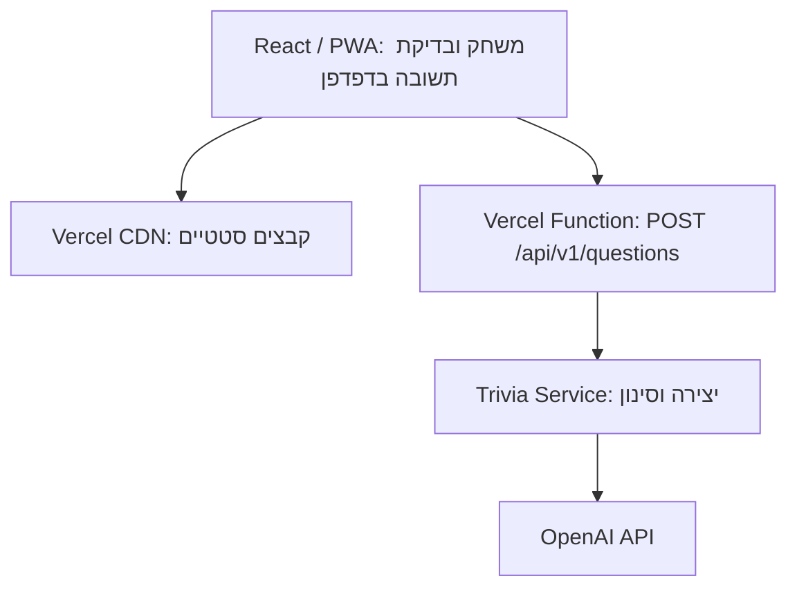

# ARCHITECTURE — BrainStorm ג'וניור

גרסה מעודכנת ומפושטת, 22.10.2026. מבוססת על ה־PRD ועל הבהרת המשתמשת: **הסוד היחיד שהאפליקציה דורשת הוא מפתח ה־AI, הנשמר בפיתוח ב־`backend/.env` בלבד**. הקוד ב־GitHub ופריסה אוטומטית ל־Vercel.

עדכון זה מפשט את התכנון הקודם: אין הצפנה של הפתרון (Question Ticket), אין קריאת ביקורת AI שנייה, מניעת חזרות מבוססת על השוואת טקסט פשוטה, ואין CI ב־GitHub Actions או חיבור ל־Vercel לפני אבן הדרך האחרונה. מהות המשחק, שלושת המסכים והעיצוב אינם משתנים. הנימוקים מפורטים ב־ADR-1 בסוף המסמך.

## 1. Technology Stack

| רכיב | בחירה | תפקיד |
| --- | --- | --- |
| Frontend | React + TypeScript במצב strict | בית, טריוויה, אודות ומצב המשחק בעברית וב־RTL, כולל בדיקת התשובה במכשיר. |
| Build / Styling | Vite + CSS Modules | Build סטטי ומימוש DESIGN.md והתמונות. |
| PWA | vite-plugin-pwa + Workbox, generateSW | Manifest ו־Precache למעטפת בלבד. |
| Backend | Vercel Functions + Node.js 24 LTS + TypeScript | יצירת שאלות בלבד (endpoint אחד). |
| Validation | Zod + JSON Schema | אימות קלט, Structured Outputs ותוצרי AI. |
| AI | OpenAI Responses API וה־SDK הרשמי | `gpt-5.4-mini-2026-03-17`, עם `store:false`. זמינות המודל נבדקת בתחילת M2. |
| Moderation | `omni-moderation-latest` + בקרת גיל ב־Prompt | סינון קלט ופלט והתאמת תוכן. |
| Database / Auth | אינם נדרשים | אין חשבונות, התחברות או שמירת משחקים בשרת. |
| קבצים | נכסים סטטיים ב־Git וב־Vercel CDN | לוגו, איורים, פונטים (Rubik, Nunito Sans) ואייקונים; אין העלאות משתמשים. מקור התמונות: תיקיית `images/` שהמשתמשת מספקת. |
| Hosting | Vercel + GitHub | אתר ו־API באותו Origin. החיבור ל־Vercel מתבצע ב־M5. |
| בדיקות | Vitest + בדיקה ידנית בדפדפן | לוגיקת המשחק, אימות פלט AI ו־API באופן אוטומטי; המסכים נבדקים ידנית. |

### נימוקי הבחירה והחלופות שנבחנו

- נבחנו React/Vite, Next.js ו־Vue/Nuxt. שלושה מסכים אינטראקטיביים אינם דורשים SSR או Server Components; React/Vite מספקים מעטפת SPA פשוטה ותיעוד נרחב המתאים לפיתוח באמצעות AI. [S1–S3]
- נבחנו Functions ב־TypeScript, Express ו־FastAPI. endpoint אחד אינו מצדיק שרת מתמשך או סביבת שפה נוספת. [S4–S6]
- נבחנו Vercel, Netlify ו־Render. Vercel עונה לדרישה המפורשת של המשתמשת ולחיבור GitHub. GitHub Pages לבדו אינו מריץ Backend; אין צורך בשרת מתמשך של Render. [S7–S9]
- נבחנו Redis, PostgreSQL ומצב זמני בדפדפן. נבחר זיכרון הדפדפן: אין Database, ORM, פרטי גישה נוספים או Database Migrations.
- נבחנו OpenAI, Claude ו־Gemini API. תנאי Gemini API אינם מאפשרים Client המיועד לקטינים. OpenAI נבחר בזכות Structured Outputs, Moderation ותיעוד לשימוש עם קטינים, בכפוף להסדר הפרטיות בסעיף 7. [S10–S13]
- נבחנו GPT-4.1 mini, GPT-5 mini ו־GPT-5.4 mini. הראשון מסומן Deprecated ו־snapshot של GPT-5 mini מתוכנן להסרה בדצמבר 2026. נבחר GPT-5.4 mini בגרסה מתוארכת. איכות עברית והתאמת גיל מחייבות בדיקות; לא בוצע Benchmark של המוצר. [S14–S15]
- נבחנו הסתרת הפתרון בשרת באמצעות Ticket מוצפן לעומת שליחתו יחד עם השאלה. במשחק ללא ניקוד ותחרות נבחרה שליחה יחד עם השאלה (ADR-1).
- נבחנו GitHub Actions ובדיקות דפדפן אוטומטיות (Playwright). ב־MVP הבדיקות רצות מקומית לפני כל Push; ניתן להוסיף CI בהמשך (ADR-1).

## 2. מבנה המערכת



Repository אחד ו־Vercel Project אחד. ה־Frontend אינו פונה ישירות ל־OpenAI. אין להסתמך על משתנה global או על קובצי Function לשמירת מצב בין מופעי Serverless.

| Module | אחריות |
| --- | --- |
| UI / Game State | שלושת המסכים, גיל, נושא, שאלה, בחירה נעולה, בדיקת התשובה ורשימת השאלות שהוצגו. |
| API Client | בקשה פעילה אחת, timeout והתעלמות מתגובה ישנה. |
| API Handler | Schema, Origin, גבולות קלט ותגובות שגיאה. |
| Trivia Service / AI Adapter | Prompts לפי גיל, יצירה, אימות מבנה ו־Moderation. |

## 3. Frontend וזרימת המשחק

הנתיבים הם `/`, `/trivia`, `/about`; ניתן להשתמש ב־History API ו־state מרכזי. כניסה לטריוויה ללא בחירת גיל מחזירה לבית. מצב המשחק נמצא מעל המסכים, ולכן מעבר לאודות וחזרה אינו מאפס אותו. רענון או פתיחה מחדש מתחילים משחק חדש.

מצבים: `idle`, `loading`, `awaiting_answer`, `answered`, `error`; מצב חיבור נפרד. בבחירת תשובה נועלים מיד את כל האפשרויות, משווים לתשובה הנכונה שכבר נמצאת בזיכרון ומציגים משוב והסבר. אין קריאת רשת בשלב המענה, ולכן ניתוק לאחר קבלת השאלה אינו מונע משוב. לאחר המשוב ניתן להמשיך או לשנות נושא.

לכל בקשת יצירה מזהה מקומי (`requestId`); רק תגובה לבקשה הפעילה מעדכנת את המסך. לחצן הבקשה (וגם שליחה ב־Enter) מושבת בזמן טעינה ובמצב `awaiting_answer`, כך שאפשר לבקש שאלה חדשה רק לאחר המענה. שינוי גיל בבית מבטל שאלה פעילה, מרוקן את שדה הנושא ומתעלם מתגובה שהתבקשה עבור הגיל הקודם, אך אינו מוחק את רשימת השאלות שהוצגו. ביטול fetch אינו מבטיח הפסקת עיבוד או חיוב אצל הספק.

התשובה הנכונה וההסבר נשמרים בזיכרון ואינם מוצגים במסך לפני המענה.

## 4. Data Model וגבולות האכיפה

| ישות | נתונים | שמירה |
| --- | --- | --- |
| Game | גיל, נושא ו־requestId פעיל | זיכרון React בלבד. |
| Question | questionId, שאלה, ארבע אפשרויות, correctOptionId והסבר | זיכרון React; הפתרון וההסבר אינם מוצגים לפני המענה. |
| Seen Questions | רשימת טקסטים מנורמלים של שאלות שהוצגו, לפי נושא מנורמל | לאורך המשחק, גם בהחלפת נושא. |
| Result | האפשרות שנבחרה ונכונותה | בזיכרון לאחר מענה בלבד. |

אין localStorage, sessionStorage, IndexedDB או Cookies של משחק. Cache Storage מכיל רק קבצי מעטפת.

### גבול מכוון: הפתרון מגיע לדפדפן

התשובה הנכונה וההסבר מגיעים לדפדפן יחד עם השאלה. הממשק אינו מציג אותם לפני הבחירה, אך משתמש היודע להשתמש בכלי המפתחים יכול לראותם. ניסיון יחיד ומניעת חזרות נאכפים בממשק בלבד. במשחק ללא ניקוד, טיימר או תחרות זו פשרה מקובלת (ADR-1); דרישה עתידית לניקוד או תחרות תחייב בחינה מחודשת.

## 5. API

JSON, HTTPS ו־`Cache-Control: no-store`, תחת `/api/v1`:

| Endpoint | קלט | פלט |
| --- | --- | --- |
| `POST /questions` | ageGroup, topic, requestId ועד 20 שאלות אחרונות שהוצגו בנושא | requestId, questionId, prompt, ארבע אפשרויות (מזהה וטקסט), correctOptionId ו־explanation. |

לנושא עד 120 תווים, עד 20 שאלות קודמות ובקשת JSON עד 16 KB. השאלות הקודמות הן רמז ליצירה ואינן מחליפות את רשימת Seen המלאה בדפדפן. מגבילים גם את גודל פלט המודל. שגיאת גודל מוצגת כבקשה לקצר קלט, ללא הוספת מסך.

מבנה שגיאה: `error: {code, message, retryable, requestId}`; message בעברית. 400 לקלט שגוי, 422 לנושא לא מובן או לא מתאים, 429 להגבלת קצב מצד הספק, 503 לכשל ספק, למיצוי תקציב או לתוצר שאינו זמין. אין הודעות ספק גולמיות.

requestId אינו receipt שמור: retry של יצירה עלול ליצור שאלה וחיוב נוספים. הלקוח מונע שליחות מקבילות ומתעלם מתגובות ישנות.

## 6. Pipeline יצירה ובקרת איכות

1. אימות, trim ו־Unicode normalization; דחיית נושא ריק או ארוך מדי.
2. Moderation לקלט. הנושא והשאלות הקודמות מטופלים כנתונים ולא כ־system instructions.
3. קריאת יצירה אחת לפי גיל, עם Structured Outputs: סטטוס (`ok`, `unsuitable_topic`, `unclear_topic`), שאלה, ארבע אפשרויות, פתרון יחיד והסבר קצר. ה־Prompt כולל את השאלות הקודמות עם הנחיה שלא לחזור עליהן, והנחיות לשאלה עובדתית וחד־משמעית.
4. אימות Zod: בדיוק ארבע אפשרויות שונות ולא ריקות, correctOptionId תקין והסבר לא ריק. refusal או פלט חסר אינם מוצגים.
5. Moderation לפלט: שאלה, אפשרויות והסבר. אין Streaming לילד לפני סיום הבדיקות.
6. השוואה לשאלות הקודמות שנשלחו בבקשה. מועמד שנפסל בשלבים 4–6 מקבל ניסיון חלופי אחד בלבד בשרת; אחריו מוחזרת שגיאה ידידותית.
7. ערבוב סדר האפשרויות בשרת והחזרה ללקוח.
8. הדפדפן משווה את הטקסט המנורמל (ללא רווחים כפולים ופיסוק) מול כל רשימת Seen. כפילות אינה מוצגת; מוצגת הודעה עם אפשרות לנסות שוב או להחליף נושא.

גיל 6–8 וגיל 9–12 מקבלים Prompts מותאמים לאוצר מילים, אורך וקושי. החלפת נושא וחזרה אליו אינן מאפסות את Seen. השוואת טקסט אינה מזהה בהכרח את אותה שאלה בניסוח שונה.

בדיקת התשובה דטרמיניסטית ומתבצעת בדפדפן, ללא AI. אין RAG, מאגר שאלות קבוע או Vector Database. אין אימות עובדתי חיצוני; יש לבדוק סט סינתטי בעברית ולסקור דוגמאות בידי מבוגר.

## 7. אבטחה, פרטיות ובקרת עלויות

### גישה והגנות

OPENAI_API_KEY הוא הסוד היחיד שמוגדר ל־Runtime. חשבונות הניהול של GitHub/Vercel אינם מפתחות שהאפליקציה מוסיפה ל־`.env`.

HTTPS, בדיקת Origin ו־Content-Type, הגבלת קלט, CSP ו־`frame-ancestors 'none'`. טקסט AI מוצג כטקסט React, ללא HTML גולמי. Origin validation אינו Authentication ואינו חוסם לבדו גישה ישירה ל־API.

### בקרת עלויות

- פרויקט OpenAI ייעודי לאפליקציה עם תקרת הוצאה חודשית, שהמשתמשת קובעת לפני הפריסה. יש לוודא בהגדרות החשבון שהתקרה חוסמת בקשות ולא רק שולחת התראה; אם אינה חוסמת — לדווח למשתמשת לפני הפריסה.
- בקוד: הגבלת output tokens, timeout וניסיון חלופי אחד בלבד לכל בקשה.
- הגבלת קצב באמצעות Vercel WAF אינה חלק מה־MVP. אם יתגלה שימוש לרעה, ניתן להוסיף אותה בתוכנית מתאימה. [S17]
- מגבלה ידועה: ללא הגבלת קצב, שימוש לרעה עלול למצות את התקציב החודשי. במקרה כזה יצירת שאלות נכשלת עם הודעה ידידותית עד חידוש התקציב, והחיוב אינו עובר את התקרה.

### שימוש עם ילדים

הסדר הפרטיות נשאר תנאי הפעלה: OpenAI דורש ZDR לפני עיבוד מידע אישי של ילדים מתחת ל־13, וקלט חופשי עלול להכיל מידע כזה. יש להסדיר ZDR מאושר ופעיל למודל ול־endpoints, בנוסף ל־store:false ובדיקת מגבלות caching/retention. ללא אישור בודקים עם נתונים סינתטיים של מבוגרים בלבד; נתיב ילדים נשאר מושבת. דגל תצורה אינו ראיה לאישור. [S12, S18]

אין שליחת IP, מזהי מכשיר או מידע שאינו נחוץ לספק AI. קלט אישי ברור נדחה, אך סינון אינו תחליף להסדר. אין Analytics או מעקב. לוגים כוללים קוד שגיאה, זמן ו־usage, ללא קלט, פתרון או מפתח.

## 8. backend/.env ו־Configuration

בפיתוח **`backend/.env`** מכיל סוד יחיד:

```dotenv
OPENAI_API_KEY=<מוגדר מקומית בלבד>
```

מציין המקום אינו מפתח אמיתי. Backend בלבד טוען במפורש קובץ זה ב־Development, למשל באמצעות `process.loadEnvFile`; קוד ה־Frontend אינו מייבא את loader הסודות. אין להפנות את Vite envDir לתיקייה זו ואין לכלול את המפתח ב־define או במשתנה עם prefix של VITE_.

ב־Vercel המפתח מוזן ישירות כמשתנה סביבה של השרת ונקרא באמצעות `process.env.OPENAI_API_KEY`. **אין להעלות את קובץ ה־.env ל־GitHub או לצפות שיגיע דרכו ל־Hosting.** שינוי משתנה Vercel דורש Redeploy. [S19]

ה־`.gitignore` שבשורש מחריג את `.env` ואת `.env.*` בכל תיקייה, כולל `backend/.env`, ומתיר את `.env.example`. `backend/.env.example` מכיל רק `OPENAI_API_KEY=` ריק. יש לבדוק באמצעות git check-ignore שהקובץ האמיתי מוחרג ו־git ls-files שאינו tracked. אם מפתח נחשף יש להחליפו ולהסיר את החשיפה, ללא הדפסת ערכו.

המודל, Origins, timeouts ודגל הפעלת ילדים הם Configuration לא סודית בקוד ה־Backend; הם אינם דורשים סודות נוספים. המפתח אינו נכלל ב־bundle, בתגובות API, ב־PWA Cache או בלוגים.

| סביבה | שמירת הסוד היחיד | שימוש |
| --- | --- | --- |
| Development | backend/.env מקומי | מפתח AI לבדיקות; אין הורדת סודות Production. |
| Production | Vercel Production Environment Variable, רצוי Sensitive | מפתח עם הסדר הפרטיות המתאים. |

## 9. GitHub, Build ו־Deployment

Repository אחד ב־GitHub: Frontend, תיקיית backend ללוגיקה ול־.env המקומי המוחרג, Prompts, נכסים, בדיקות ותצורה. `/api` בשורש מכילה adapter של Vercel Function המייבא את לוגיקת ה־backend. ה־Frontend אינו מייבא מודולי שרת.

**פיתוח מקומי (M1–M4):** שרת הפיתוח של Vite מפעיל את אותו handler דרך middleware בנתיב `/api/v1/questions`, כך שאין צורך בחשבון Vercel בשלבים אלה. העבודה נעשית על `main`. לפני כל Push מריצים מקומית type-check, lint, בדיקות Vitest ו־vite build.

**פריסה (M5):** חיבור GitHub ישיר ל־Vercel. מרגע החיבור, Push ל־`main` יוצר פריסת Production אוטומטית; Push לענף אחר יוצר Preview. פלט UI ב־dist; ה־Function נפרסת באותו פרויקט. rewrites למעטפת חלים על נתיבי UI בלבד, לא על api. [S1, S4, S7]

Node.js 24 LTS עם Fluid Compute. maxDuration ליצירה 60 שניות, deadline כולל 30 שניות ועד 20 שניות לכל קריאת מודל בתוך הזמן שנותר. [S4, S20]

גרסאות Stable ו־lockfile. אין Docker או פקודת פריסה ידנית בכל עדכון. Rollback באמצעות החזרה לפריסה קודמת ב־Vercel.

## 10. PWA ו־Offline

Manifest בעברית ו־RTL, start_url ו־scope לשורש, standalone ואייקונים רגילים ו־maskable, הנגזרים מ־`images/app-icon.png`. Workbox מבצע Precache לכל chunks של המסכים, לאיורים, לפונטים ולאייקונים. [S21]

API הוא NetworkOnly ומוחרג מ־Cache ומ־fallback. אין נושאים, שאלות או תשובות ב־Cache Storage. בלי רשת אפשר לפתוח מעטפת שנטענה מראש, ולענות על שאלה שכבר מוצגת; אין יצירת שאלות. אין Background Sync או Offline queue. רענון מאפס משחק.

עדכון Service Worker אינו גורם ל־reload כפוי בזמן משחק. Service Worker נבדק מקומית ב־Build אמיתי (`vite preview` על localhost); התקנה בטלפון אמיתי נבדקת ב־M5 בכתובת HTTPS. התקנה תלויה בדפדפן; שימוש באתר אינו מחייב התקנה.

## 11. עלויות ואימות

אין עלות Database, Auth או שירות אחסון נוסף. Vercel Hobby לשימוש אישי לא מסחרי; שימוש מסחרי מחייב Pro, המוצג החל מ־20 דולר לחודש. [S22]

GPT-5.4 mini בתעריף Standard: 0.75 דולר למיליון input tokens ו־4.50 דולר למיליון output tokens. Moderation ללא חיוב endpoint, בכפוף למכסות. דוגמה בלבד: קריאת יצירה אחת של כ־2,000 input ו־800 output tokens עולה כ־0.005 דולר לשאלה, כ־5 דולר ל־1,000 שאלות, לפני ניסיונות חלופיים, Hosting, מיסים או תנאים מסחריים להסדר ZDR. צריכה ו־latency של המוצר לא נמדדו. [S14, S23]

בדיקות אוטומטיות (Vitest): נעילת בחירה ובדיקת תשובה, אימות פלט AI תקין ופגום באמצעות Fixtures, נרמול והשוואת כפילויות, התעלמות מתגובה ישנה, אימות קלט API וסריקת bundle לסודות. בדיקות ידניות: שלושת המסכים מול העיצוב, RTL, רוחבי מובייל, Offline ו־PWA, ודוגמאות בעברית לשני הגילים.

## 12. מקורות רשמיים

- **S1:** [Vite Deployment](https://vite.dev/guide/static-deploy.html)
- **S2:** [React](https://react.dev/learn/creating-a-react-app)
- **S3:** [Next.js PWA](https://nextjs.org/docs/app/guides/progressive-web-apps), [Nitro](https://nitro.build/docs/quick-start)
- **S4:** [Vercel Node.js](https://vercel.com/docs/functions/runtimes/node-js), [Versions](https://vercel.com/docs/functions/runtimes/node-js/node-js-versions)
- **S5:** [Express](https://expressjs.com/)
- **S6:** [FastAPI](https://fastapi.tiangolo.com/features/)
- **S7:** [Vercel GitHub](https://vercel.com/docs/git/vercel-for-github)
- **S8:** [Netlify Functions](https://www.netlify.com/platform/functions/)
- **S9:** [Render](https://render.com/docs/free)
- **S10:** [Gemini API Terms](https://ai.google.dev/gemini-api/terms)
- **S11:** [Anthropic Minors Guidance](https://support.claude.com/en/articles/9307344-responsible-use-of-anthropic-s-models-guidelines-for-organizations-serving-minors)
- **S12:** [OpenAI Under-18 Guidance](https://developers.openai.com/api/docs/guides/safety-checks/under-18-api-guidance)
- **S13:** [Structured Outputs](https://developers.openai.com/api/docs/guides/structured-outputs), [Zod](https://zod.dev/)
- **S14:** [GPT-5.4 mini](https://developers.openai.com/api/docs/models/gpt-5.4-mini)
- **S15:** [OpenAI Deprecations](https://developers.openai.com/api/docs/deprecations)
- **S17:** [Vercel WAF Rate Limiting](https://vercel.com/docs/vercel-firewall/vercel-waf/rate-limiting), [WAF Pricing](https://vercel.com/docs/vercel-firewall/vercel-waf/usage-and-pricing)
- **S18:** [OpenAI Data Controls](https://developers.openai.com/api/docs/guides/your-data)
- **S19:** [Vercel Environment Variables](https://vercel.com/docs/environment-variables), [Managing Variables](https://vercel.com/docs/environment-variables/managing-environment-variables)
- **S20:** [Vercel Functions Limits](https://vercel.com/docs/functions/limitations)
- **S21:** [Vite PWA Precache](https://vite-pwa-org.netlify.app/guide/service-worker-precache)
- **S22:** [Vercel Pricing](https://vercel.com/pricing), [Hobby](https://vercel.com/docs/plans/hobby)
- **S23:** [OpenAI Moderation](https://developers.openai.com/api/docs/guides/moderation)

## החלטות מרכזיות (ADRs)

### ADR-1: פישוט הארכיטקטורה ל־MVP

**הקשר:** התכנון הקודם כלל הצפנת הפתרון ב־Ticket שמפתחו נגזר ממפתח ה־AI, קריאת ביקורת AI שנייה לכל שאלה, טביעות אצבע מוצפנות לזיהוי כפילויות, CI ב־GitHub Actions עם branch protection, חיבור ל־Vercel כבר ב־M1, הגבלת קצב ב־Vercel WAF ובדיקות Playwright מלאות. למשחק ללא ניקוד ותחרות, שמפותח בידי משתמשת שאינה מתכנתת, המורכבות הזו מייקרת, מאטה ומקשה על בדיקה, בלי להוסיף ערך מהותי לילד. המשתמשת אישרה את הפישוט בתנאי שמהות המשחק לא משתנה.

**החלטה:**
1. התשובה הנכונה וההסבר נשלחים יחד עם השאלה, והבדיקה מתבצעת בדפדפן. אין Ticket, הצפנה או endpoint לבדיקת תשובה.
2. קריאת AI אחת ליצירה, עם Structured Outputs, אימות Zod ו־Moderation, ללא קריאת ביקורת נפרדת.
3. מניעת חזרות באמצעות השוואת טקסט מנורמל ושליחת השאלות האחרונות למודל, ללא fingerprints מוצפנים.
4. בדיקות מקומיות לפני כל Push במקום GitHub Actions ו־branch protection; עבודה על `main`.
5. חיבור ל־Vercel ב־M5 בלבד; עד אז פיתוח ובדיקה מקומיים.
6. תקרת הוצאה בפרויקט OpenAI ייעודי ומגבלות בקוד במקום Vercel WAF.
7. Vitest ללוגיקה ובדיקה ידנית של המסכים במקום חבילת Playwright מלאה.

**השלכות:**
- משתמש בעל ידע טכני יכול לחשוף את התשובה מראש בכלי המפתחים. ה־PRD עודכן בהתאם.
- בדיקת התשובה עובדת גם ללא חיבור לאחר קבלת השאלה; מקרה הקצה של ניתוק בזמן בדיקה נעלם.
- עלות וזמן המתנה לשאלה קטנים בערך פי שניים; סיכון מעט גבוה יותר לשאלה שגויה או דו־משמעית. אם הסקירה בבדיקות תמצא בעיות רבות, תיבחן החזרת קריאת הביקורת.
- שאלה עשויה לחזור בניסוח שונה.
- אין חסימה אוטומטית של קוד שבור לפני Push, ואין בדיקה בטלפון אמיתי דרך קישור לפני M5.
- ללא הגבלת קצב, שימוש לרעה עלול למצות את התקציב החודשי ולעצור את יצירת השאלות עד חידושו.
- ניתן להחזיר כל אחד מהרכיבים בהמשך, אם יתווספו ניקוד, תחרות או שימוש רחב.

### ADR-2: פרטי מימוש של המעטפת ב־M1

**הקשר:** ב־M1 נדרשו כמה החלטות מימוש שה־Architecture לא קבע: ניתוב בין שלושת המסכים, טעינת הגופנים, שמות קובצי התמונות, צורת ה־adapter ל־Vercel וגרסת TypeScript.

**החלטה:**
1. ניתוב באמצעות `react-router-dom` (History API) לנתיבים `/`, `/trivia`, `/about`; מצב המשחק ב־React Context מעל המסכים.
2. הגופנים Rubik ו־Nunito Sans נטענים מקומית מחבילות `@fontsource`, ולא מ־Google Fonts, כדי שייכללו ב־Precache של ה־PWA ב־M4 ולא ישלחו בקשות לצד שלישי.
3. התמונות מ־`images/` מועתקות ל־`public/images/` בשמות נקיים (`logo.png`, `hero.png`, `about.png`, `background.png`, `app-icon.png`); המקור נשאר כפי שהוא.
4. ה־adapter ב־`api/v1/questions.ts` משתמש בחתימת Web standard (`Request`/`Response`) ללא החבילה `@vercel/node`, שהוסיפה תלויות עם אזהרות אבטחה.
5. TypeScript 6.0 (ולא 7) בגלל תאימות ל־typescript-eslint.

**השלכות:**
- אין תלות בשירות גופנים חיצוני; גודל ה־Build גדל מעט בקובצי הגופנים.
- שינוי שם או החלפה של תמונה ב־`images/` מחייב העתקה מחודשת ל־`public/images/`.
- כשתצא גרסת typescript-eslint התומכת ב־TypeScript 7 ניתן לשדרג.

### ADR-3: פרטי מימוש של יצירת השאלה ב־M2

**הקשר:** ב־M2 נדרשו החלטות מימוש שה־Architecture לא קבע: אופן בדיקת ה־Origin, העברת הסכמה ל־Structured Outputs, מגבלות הפלט, timeout בצד הלקוח ואופן בדיקת ה־Pipeline בלי רשת.

**החלטה:**
1. בדיקת Origin משווה את המארח שבכותרת `Origin` לכותרת `Host` של הבקשה (אותו Origin בפיתוח, ב־preview וב־Vercel), במקום רשימת כתובות קבועה. בקשה בלי `Origin` מתקבלת.
2. ה־JSON Schema ל־Structured Outputs נכתב ידנית ב־`backend/questionSchema.ts`, ואימות Zod רץ בנפרד אחריו — בלי ה־helper של ה־SDK ל־Zod, כדי לא להיות תלויים בתאימות בין גרסאות `openai` ו־`zod`.
3. `max_output_tokens` = 1600 (כולל reasoning) ו־reasoning effort נמוך, להגבלת עלות וזמן המתנה. `maxRetries: 0` ב־SDK; הניסיון החלופי היחיד מנוהל בקוד.
4. timeout בצד הלקוח של 35 שניות — מעט מעל ה־deadline של 30 שניות בשרת — כך שהטעינה תמיד מסתיימת.
5. שכבת ה־AI מוגדרת כממשק (`AiClient`) המוזרק ל־handler; הבדיקות משתמשות במימוש מזויף עם Fixtures, בלי רשת ובלי מפתח.
6. דגל `CHILD_USE_APPROVED = false` ב־`backend/config.ts`. ב־M2 האפליקציה רצה מקומית בלבד; האכיפה בפועל ב־Production תיקבע ב־M5, לאחר אימות ZDR.

**השלכות:**
- בדיקת ה־Origin אינה הזדהות; קריאה ישירה ל־API ללא דפדפן עדיין אפשרית, כפי שכבר מתועד בסעיף 7.
- שינוי מבנה השאלה מחייב עדכון גם של ה־JSON Schema וגם של סכמת Zod.
- אם תשובות המודל ייחתכו בגלל מגבלת הטוקנים, יש להגדיל את `MAX_OUTPUT_TOKENS` ב־`backend/config.ts`.

### ADR-4: פרטי מימוש של המשך המשחק ומניעת חזרות ב־M3

**הקשר:** ב־M3 נדרשו החלטות שה־Architecture לא קבע במדויק: כללי הנרמול להשוואת שאלות, מה נחשב "אותו נושא", טיפול בשאלות הקודמות שמגיעות מהדפדפן, זיהוי מצב Offline והתנהגות עריכת השדה בזמן טעינה.

**החלטה:**
1. נרמול להשוואה (`normalizeForCompare`): NFC, הסרת ניקוד, החלפת פיסוק וסמלים ברווח, איחוד רווחים ואותיות קטנות. אותה פונקציה ממומשת ב־`backend/questionSchema.ts` וב־`src/game/seen.ts` (ה־Frontend אינו מייבא מודולי שרת), עם אותה טבלת בדיקות בשני הצדדים.
2. רשימת Seen נשמרת ב־`useRef` לפי נושא מנורמל, כך ש„חלל” ו„חלל.” הם אותו נושא. היא אינה תלויה בגיל ואינה מוגבלת בגודלה; רק 20 האחרונות נשלחות לשרת.
3. השאלות הקודמות מגיעות מהדפדפן ולכן עוברות Moderation יחד עם הנושא, ונשלחות למודל כנתון תחום בתגיות. מועמד ששאלתו זהה לאחת מהן נפסל ונספר כניסיון, כך שנשמרת התקרה של שתי קריאות יצירה לבקשה.
4. כפילות שעברה את השרת נפסלת בדפדפן מול כל רשימת Seen, בלי ניסיון אוטומטי נוסף; מוצגת הודעה והילד יכול לנסות שוב או להחליף נושא.
5. Offline מזוהה ב־`navigator.onLine` בזמן הבקשה (וגם בכשל רשת), בלי מאזין קבוע. השאלה והמשוב שכבר מוצגים נשארים במסך.
6. requestId נוצר בדפדפן לכל בקשה; רק תגובה לבקשה הפעילה מעדכנת את המסך. עריכת שדה הנושא בזמן טעינה אינה מבטלת את הבקשה; „עוד שאלה באותו נושא” משתמש בנושא שבו התבקשה השאלה המוצגת ומחזיר אותו לשדה.

**השלכות:**
- שינוי בכללי הנרמול מחייב עדכון בשני הקבצים.
- שאלה זהה בניסוח שונה עדיין עשויה לחזור (מגבלה ידועה מ־ADR-1).
- `navigator.onLine` אינו מבטיח חיבור אמיתי; במקרה כזה כשל הרשת מסתיים בהודעה הכללית.

### ADR-5: פרטי מימוש של ה־PWA ב־M4

**הקשר:** ב־M4 נדרשו החלטות שה־Architecture לא קבע במדויק: איך מתבצע עדכון גרסה בלי reload כפוי, איך נוצרים האייקונים, אילו קבצים נכנסים ל־Precache, והאם ה־Service Worker פעיל בפיתוח. בנוסף התגלה שבשרת `vite preview` (שרץ עם `NODE_ENV=production`) המפתח מ־`backend/.env` לא נטען.

**החלטה:**
1. `vite-plugin-pwa` במצב `generateSW` עם `registerType: 'prompt'` **ללא ממשק עדכון** ובלי `skipWaiting`/`clientsClaim`: גרסה חדשה מותקנת ברקע וממתינה עד שכל לשוניות האפליקציה נסגרות. אין הודעת „יש עדכון” — רכיב שאינו במקורות.
2. האייקונים נוצרים פעם אחת מ־`public/images/app-icon.png` באמצעות `@vite-pwa/assets-generator` (`npm run icons`, תצורה ב־`pwa-assets.config.ts`) ונשמרים ב־Git לצד המקור ב־`public/images/`. לאייקון ה־maskable ול־Apple אין שוליים נוספים, כי לאייקון המקורי רקע מלא והאיור בתוך האזור הבטוח.
3. Precache: כל קובצי `js`, `css`, `html`, `png`, `ico`, `webmanifest` ו־`woff2` מ־`dist/` (כולל כל ה־subsets של הגופנים), למעט `app-icon.png` בגודל 1024 שאינו נטען באפליקציה. מגבלת הגודל לקובץ הוגדלה ל־3 MB בשביל `background.png`. סה"כ כ־4 MB.
4. `/api/` מוחרג מ־`navigateFallback` ומוגדר `NetworkOnly` במפורש (GET ו־POST).
5. ה־Service Worker כבוי ב־`npm run dev`; ה־PWA נבדק רק ב־`npm run build` + `npm run preview`. הבדיקה האוטומטית `npm run check:pwa` מאמתת את ה־Manifest, רשימת ה־Precache וחוקי ה־API ב־`dist/`.
6. `loadServerEnv` מדלג על `backend/.env` רק כשמשתנה `VERCEL` מוגדר (במקום `NODE_ENV=production`), כך ש־`vite preview` המקומי מקבל את המפתח, וב־Vercel המפתח מגיע מהגדרות הפלטפורמה.

**השלכות:**
- משתמש שמשאיר את האפליקציה פתוחה זמן רב יקבל גרסה חדשה רק אחרי סגירה ופתיחה מחדש.
- החלפת `images/app-icon.png` מחייבת העתקה ל־`public/images/` והרצת `npm run icons`.
- הורדה ראשונה של כ־4 MB לשמירה במכשיר; ניתן לצמצם בעתיד ל־subsets העברית והלטינית בלבד או לדחוס את התמונות.

### ADR-6: פרטי הפריסה ל־Vercel ב־M5

**הקשר:** ב־M5 נדרשו החלטות שה־Architecture לא קבע במדויק: תצורת Vercel (rewrites, headers, Cache), אופן היבוא בין קובצי ה־Backend כך שה־Function תרוץ ב־Vercel, היקף משתנה הסביבה, ומעמד תנאי ה־ZDR ותקרת ההוצאה. בנוסף הובהר שהפרויקט הוא עבודת בית של תלמידה, שאינו מפורסם ואינו משותף עם ילדים, ושמפתח ה־AI ניתן על ידי המורה, שאישרה את השימוש בו באתר החי.

**החלטה:**
1. `vercel.json` בשורש: Build של Vite ל־`dist`, `maxDuration: 60` ל־`api/v1/questions.ts`, rewrite של כל נתיב שאינו `/api/` ל־`/index.html`, ו־headers: CSP מחמיר (`'self'` בלבד, `frame-ancestors 'none'`), `nosniff`, `Referrer-Policy`, `Permissions-Policy`; `max-age=0` ל־`sw.js`, `registerSW.js`, `index.html` ו־Manifest, ו־`immutable` ל־`/assets/`.
2. היבוא בין קובצי `api/` ו־`backend/` נכתב עם סיומת `.js` (במקום `.ts`). Vercel מתרגם כל קובץ TypeScript בנפרד ואינו משנה את נתיבי היבוא, ולכן יבוא `.ts` נכשל בזמן ריצה. TypeScript, Vite ו־Vitest מפנים `.js` לקובץ ה־`.ts` המתאים. `scripts/check-model.mjs` ממשיך לייבא `.ts` ישירות, כי הוא רץ ב־Node ללא תרגום, והקבצים שהוא מייבא אינם מייבאים קבצים מקומיים.
3. `engines.node` = `24.x`.
4. `OPENAI_API_KEY` מוגדר ב־Vercel ל־Production בלבד (Sensitive), לא ל־Preview; בפריסות Preview מוצגת הודעת „שירות השאלות עדיין לא מוגדר”.
5. **ZDR — לא רלוונטי** לפרויקט לימודי שאינו מפורסם (החלטת המשתמשת, 23.10.2026). הכתובת החיה היא גרסת בדיקה עם תוכן סינתטי, אינה משותפת עם ילדים, ו־`CHILD_USE_APPROVED` נשאר `false`.
6. **תקרת ההוצאה** באחריות המורה, בעלת החשבון שאליו שייך המפתח, שאישרה את השימוש. לתלמידה אין גישה לחשבון, ולכן התקרה לא נבדקה על ידינו; ההודעה למיצוי תקציב נבדקת ב־Vitest.
7. `npm run check:live -- <url>` בודק כתובת חיה בלי ליצור שאלה (ללא עלות).

**השלכות:**
- קובץ חדש ב־`backend/` צריך לייבא קבצים מקומיים עם סיומת `.js`.
- האתר אינו מוצר מוכן לשימוש ילדים; שימוש כזה יחייב הסדר ZDR, החלפת הדגל ותקרת הוצאה מאומתת.
- הכתובת ציבורית ואין הגבלת קצב: מי שיודע אותה יכול לבקש שאלות על חשבון המורה. לכן לא מפיצים אותה, ובסיום אפשר למחוק את המפתח מ־Vercel.
- כל Push ל־`main` מפרסם מיד ל־Production; יש להריץ את הבדיקות המקומיות לפני כל Push.
