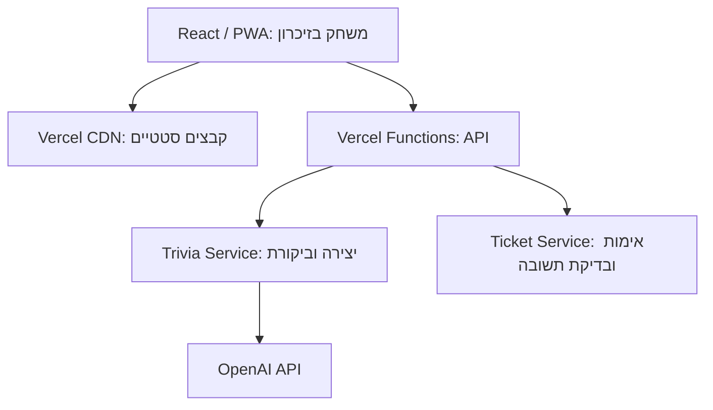

# ARCHITECTURE — BrainStorm ג'וניור

גרסה מעודכנת, 22.10.2026. מבוססת על ה־PRD ועל הבהרת המשתמש: **הסוד היחיד שהאפליקציה דורשת הוא מפתח ה־AI, הנשמר בפיתוח ב־`backend/.env` בלבד**. הקוד ב־GitHub ופריסה אוטומטית ל־Vercel.

התכנון המעודכן מחליף את Redis ואת מפתחות האחסון וההצפנה הנפרדים במצב משחק בזיכרון הדפדפן וב־Backend מסוג Stateless. מבנה שלושת המסכים והעיצוב אינם משתנים. מגבלות האכיפה מוסברות בסעיף 4.

## 1. Technology Stack

| רכיב | בחירה | תפקיד |
| --- | --- | --- |
| Frontend | React + TypeScript במצב strict | בית, טריוויה, אודות ומצב המשחק בעברית וב־RTL. |
| Build / Styling | Vite + CSS Modules | Build סטטי ומימוש DESIGN.md והתמונות. |
| PWA | vite-plugin-pwa + Workbox, generateSW | Manifest ו־Precache למעטפת בלבד. |
| Backend | Vercel Functions + Node.js 24 LTS + TypeScript | יצירה וביקורת של שאלות ובדיקת תשובות. |
| Validation | Zod + JSON Schema | אימות קלט, Structured Outputs ותוצרי AI. |
| AI | OpenAI Responses API וה־SDK הרשמי | `gpt-5.4-mini-2026-03-17`, עם `store:false`. |
| Moderation | `omni-moderation-latest` + בקרת גיל ב־Prompt | סינון קלט ופלט והתאמת תוכן. |
| הצפנה | node:crypto: HKDF-SHA256 ו־AES-256-GCM | הסתרת הפתרון ב־Question Ticket; ללא סוד מוגדר נוסף. |
| Database / Auth | אינם נדרשים | אין חשבונות, התחברות או שמירת משחקים בשרת. |
| קבצים | נכסים סטטיים ב־Git וב־Vercel CDN | לוגו, תמונה, פונטים ואייקונים; אין העלאות משתמשים. |
| Hosting / CI | Vercel + GitHub + GitHub Actions | אתר ו־API באותו Origin, בדיקות ופריסה אוטומטית. |
| בדיקות | Vitest + Playwright | לוגיקה, API, מובייל, RTL ו־PWA. |

### נימוקי הבחירה והחלופות שנבחנו

- נבחנו React/Vite, Next.js ו־Vue/Nuxt. שלושה מסכים אינטראקטיביים אינם דורשים SSR או Server Components; React/Vite מספקים מעטפת SPA פשוטה ותיעוד נרחב המתאים לפיתוח באמצעות AI. [S1–S3]
- נבחנו Functions ב־TypeScript, Express ו־FastAPI. שני endpoints אינם מצדיקים שרת מתמשך או סביבת שפה נוספת. [S4–S6]
- נבחנו Vercel, Netlify ו־Render. Vercel עונה לדרישה המפורשת של המשתמש ולחיבור GitHub. GitHub Pages לבדו אינו מריץ Backend; אין צורך בשרת מתמשך של Render. [S7–S9]
- נבחנו Redis, PostgreSQL ומצב זמני בדפדפן. בעקבות מגבלת הסוד היחיד נבחר זיכרון הדפדפן, עם גבול אכיפה מפורש. אין Database, ORM, פרטי גישה נוספים או Database Migrations.
- נבחנו OpenAI, Claude ו־Gemini API. תנאי Gemini API אינם מאפשרים Client המיועד לקטינים. OpenAI נבחר בזכות Structured Outputs, Moderation ותיעוד לשימוש עם קטינים, בכפוף להסדר הפרטיות בסעיף 7. [S10–S13]
- נבחנו GPT-4.1 mini, GPT-5 mini ו־GPT-5.4 mini. הראשון מסומן Deprecated ו־snapshot של GPT-5 mini מתוכנן להסרה בדצמבר 2026. נבחר GPT-5.4 mini בגרסה מתוארכת, במקום מודל גדול ויקר או מודל לקראת הסרה. איכות עברית והתאמת גיל מחייבות בדיקות; לא בוצע כאן Benchmark של המוצר. [S14–S15]

## 2. מבנה המערכת



Repository אחד ו־Vercel Project אחד. ה־Frontend אינו פונה ישירות ל־OpenAI. כל הגישה לספק וכל טיפול בפתרון הגלוי מתבצעים בשרת. אין להסתמך על משתנה global או על קובצי Function לשמירת מצב משותף בין מופעי Serverless.

| Module | אחריות |
| --- | --- |
| UI / Game State | שלושת המסכים, גיל, נושא, שאלה, בחירה נעולה וזיכרון חזרות. |
| API Client | בקשה פעילה אחת, timeout וזיהוי תגובה ישנה. |
| API Handlers | Schema, Origin, גבולות קלט ותגובות שגיאה. |
| Trivia Service / AI Adapter | Prompts, יצירה, סינון וביקורת. |
| Ticket Service | מעטפת מוצפנת ובדיקת תשובה דטרמיניסטית. |

## 3. Frontend וזרימת המשחק

הנתיבים הם `/`, `/trivia`, `/about`; ניתן להשתמש ב־History API ו־state מרכזי. כניסה לטריוויה ללא בחירת גיל מחזירה לבית. מצב המשחק נמצא מעל המסכים, ולכן מעבר לאודות וחזרה אינו מאפס אותו. רענון או פתיחה מחדש מתחילים משחק חדש.

מצבים: `idle`, `loading`, `awaiting_answer`, `submitting`, `answered`, `error`; מצב חיבור נפרד. בבחירת תשובה נועלים מיד את כל האפשרויות לפני בקשת הרשת. בכשל נשמרים מזהה השאלה, ה־Ticket והאפשרות הראשונה; לאחר חזרת החיבור נשלחת רק אותה בחירה. לאחר משוב ניתן להמשיך או לשנות נושא.

לכל בקשת יצירה `requestId` ו־revision מקומי. רק תגובה השייכת לפעולה הפעילה מעדכנת את המסך. שינוי גיל בבית מבטל שאלה פעילה ומעדכן revision, אך אינו מוחק שאלות שכבר נראו. ביטול fetch אינו מבטיח הפסקת עיבוד או חיוב אצל הספק.

## 4. Data Model וגבולות האכיפה

| ישות | נתונים | שמירה |
| --- | --- | --- |
| Game | גיל, נושא, revision ומזהי בקשות | זיכרון React בלבד. |
| Public Question | שאלה, ארבע אפשרויות, מזהה, fingerprints ו־Ticket | זיכרון React, ללא פתרון גלוי. |
| Seen Questions | Set של שאלות מנורמלות ו־fingerprints ותקצירים אחרונים | לאורך המשחק, גם בהחלפת נושא. |
| Pending Answer | מזהה שאלה, האפשרות הראשונה ו־Ticket | עד לקבלת משוב; retry אינו משנה בחירה. |
| Result | נכונות, פתרון והסבר | בזיכרון לאחר מענה בלבד. |
| Question Ticket | payload מוצפן עם השאלה, האפשרויות, הפתרון וההסבר | נשלח ללקוח כמחרוזת אטומה; אין עותק שמור בשרת. |

אין localStorage, sessionStorage, IndexedDB או Cookies של משחק. Cache Storage מכיל רק קבצי מעטפת. אין Session API, מאגר, heartbeat או TTL של רשומת שרת.

### Question Ticket ללא סוד נוסף

השרת גוזר מ־`OPENAI_API_KEY` מפתח 32 bytes באמצעות HKDF-SHA256 עם salt ציבורי קבוע ו־context ייעודי לגרסת המוצר. המפתח הנגזר זמני בזיכרון השרת בלבד; המשתמש אינו מגדיר או שומר סוד נוסף. גזירה עם context אחר משמשת ל־HMAC של factKey. אין שימוש ישיר במפתח הספק כמפתח AES. [S16]

Ticket מוצפן ב־AES-256-GCM עם nonce אקראי חדש של 12 bytes ו־tag של 16 bytes. המעטפת כוללת גרסה, nonce, ciphertext ו־tag; ה־payload כולל questionId, ארבע אפשרויות, correctOptionId, הסבר, issuedAt ו־expiresAt של 24 שעות. אין בו מפתח ספק או פרטים אישיים. Base64 או JWT חתום בלבד אינם מסתירים פתרון ואינם תחליף להצפנה. [S16]

ב־`/answers` מאמתים tag, גרסה, תפוגה, questionId וחברות האפשרות ברשימה, ומשווים לפתרון. Ticket ששונה או שפג נדחה בלי משוב מומצא. אותה מעטפת ואותה בחירה מחזירות תוצאה דטרמיניסטית ללא AI. החלפת מפתח הספק מבטלת Tickets קיימים; יש להציג בקשה לקבל שאלה חדשה.

### גבול מהותי: נעילת ממשק ולא Anti-cheat בשרת

השרת אינו שומר אם Ticket כבר נבדק. הוא אינו יכול למנוע מלקוח ששונה לשלוח אליו אפשרויות שונות לאותה שאלה. הצפנה מונעת קריאה ושינוי של הפתרון, אך אינה מונעת replay של מעטפת תקינה. ניסיון יחיד נאכף ב־UI ובמצב הבחירה בדפדפן בלבד, ולא אטומית בין לקוחות או מופעי שרת.

מניעת חזרות תלויה גם היא ב־Set המלא שבדפדפן. אין הבטחה נגד שינוי קוד הלקוח או היסטורייתו. אין להציג תכנון זה כאכיפה שרתית עמידה לשינוי לקוח; דרישה כזו תחייב בחינה מחודשת של אחסון או שירות מתאים. הגבלה זו מתועדת גם ב־PRD וב־Milestones.

## 5. APIs

JSON, HTTPS ו־`Cache-Control: no-store`, תחת `/api/v1`:

| Endpoint | קלט | פלט |
| --- | --- | --- |
| `POST /questions` | ageGroup, topic, requestId ותקצירים אחרונים מוגבלים | requestId, questionId, prompt, ארבע אפשרויות, fingerprints ו־Ticket מוצפן. |
| `POST /answers` | questionId, selectedOptionId, ticket | isCorrect, correctOptionId והסבר עבור ה־Ticket המאומת. |

לנושא עד 120 תווים, עד 20 תקצירים ובקשת JSON עד 16 KB. תקצירים הם רמז בלתי מהימן ליצירה ואינם מחליפים את רשימת Seen המלאה בדפדפן. מגבילים גם גודל Tickets ופלט מודל. שגיאת גודל מוצגת כבקשה לקצר קלט, ללא הוספת מסך.

אין פתרון או הסבר בטקסט גלוי ב־DTO לפני מענה. מזהי האפשרויות וסדרן נקבעים בשרת לפני הצפנת ה־Ticket; השרת אינו סומך על isCorrect או על פתרון מהלקוח.

מבנה שגיאה: `error: {code, message, retryable, requestId}`; message בעברית. 400 לקלט/Ticket שגוי, 422 לנושא לא מובן/לא מתאים, 429 להגבלת קצב, 503 לכשל ספק או לתוצר שאינו זמין ו־410 ל־Ticket שפג. אין הודעות ספק גולמיות.

requestId אינו receipt שמור: retry של יצירה עלול ליצור שאלה וחיוב נוספים. הלקוח מונע שליחות מקבילות ומתעלם מתגובות ישנות; אין הבטחה ל־Exactly-once generation בשרת. retry של מענה משתמש באותו Ticket ובאותה בחירה, ללא קריאת AI.

## 6. Pipeline יצירה ובקרת איכות

1. אימות, trim ו־Unicode normalization; דחיית נושא ריק או ארוך מדי.
2. Moderation לקלט. נושא ותקצירים מטופלים כנתונים ולא כ־system instructions.
3. יצירת מועמד לפי גיל: שאלה, ארבע אפשרויות, פתרון יחיד, הסבר קצר ו־factKey פנימי; status ללא שאלה בנושא לא מתאים/מובן.
4. Structured Outputs ו־Zod: ארבע תשובות שונות ולא ריקות, פתרון תקין והסבר. refusal או פלט חסר אינם מוצגים.
5. ביקורת ב־request נפרד באותו מודל: פתרון ללא סימון תשובת המחולל, חד־משמעיות והתאמת גיל. משווים את מסקנת המבקר לפתרון ולהסבר; ספק פוסל מועמד.
6. Moderation לפלט ובקרת גיל ייעודית. כל תקציר הנשלח למודל נבדק כקלט. אין Streaming לילד לפני סיום הביקורת.
7. חישוב fingerprint של שאלה מנורמלת ו־HMAC של factKey במפתח נגזר ייעודי, ערבוב אפשרויות והחזרת Ticket מוצפן.
8. הדפדפן משווה מול כל ה־Set לפני הצגה. כפילות אינה מוצגת. לכל בקשת משתמש מותר מועמד ראשוני וחלופי אחד בסך הכול, כולל ניסיון שנדרש עקב כפילות בלקוח. הגבול מתואם בזרימת UI; הוא אינו אכיפה מול לקוח ששונה.

גיל 6–8 וגיל 9–12 מקבלים Prompts מותאמים לאוצר מילים, אורך וקושי. החלפת נושא וחזרה אינן מאפסות Seen. fingerprint מזהה שאלה מנורמלת; factKey וביקורת מצמצמים כפילות בניסוח אחר אך אינם מבטיחים זיהוי סמנטי מושלם.

בדיקת תשובה דטרמיניסטית, ללא AI. אין RAG, מאגר שאלות קבוע או Vector Database. ביקורת של אותו מודל אינה אימות עובדתי חיצוני; יש לבדוק סט סינתטי בעברית ולסקור דוגמאות בידי מבוגר.

## 7. אבטחה, פרטיות ובקרת עלויות

### גישה והגנות

OPENAI_API_KEY הוא הסוד היחיד שמוגדר ל־Runtime. חשבונות הניהול של GitHub/Vercel אינם מפתחות שהאפליקציה מוסיפה ל־`.env`. אין Redis token או מפתח הצפנה נפרד.

HTTPS, בדיקת Origin ו־Content-Type, הגבלת קלט, CSP ו־`frame-ancestors 'none'`. טקסט AI מוצג כטקסט React, ללא HTML גולמי. Origin validation אינו Authentication ואינו חוסם לבדו גישה ישירה ל־API.

Rate limiting באמצעות כלל Vercel WAF לנתיבי API, בתוכנית התומכת בכך, ללא secret נוסף ב־Runtime. אין מונה אבטחה ב־global של Function. יש לבדוק זמינות ועלות של הכלל בפועל ב־Preview וב־Production; אין להניח שכל WAF חינמי. [S17]

מגבילים ניסיונות, output tokens וזמן; משתמשים במכסות ובתקציב/התראות ספק. ללא אחסון משותף אין מונה תקציב יומי אטומי באפליקציה, ואין להבטיח שהתראה היא Hard cap. אם התוכנית מאפשרת חסם הוצאה, מפעילים ובודקים בנפרד. חסימת AI אינה מונעת בדיקת Ticket תקין, כל עוד מפתח ההצפנה הנגזר לא השתנה.

### שימוש עם ילדים

הסדר הפרטיות נשאר תנאי הפעלה: OpenAI דורש ZDR לפני עיבוד מידע אישי של ילדים מתחת ל־13, וקלט חופשי עלול להכיל מידע כזה. יש להסדיר ZDR מאושר ופעיל למודל ול־endpoints, בנוסף ל־store:false ובדיקת מגבלות caching/retention. ללא אישור בודקים עם נתונים סינתטיים של מבוגרים בלבד; נתיב ילדים נשאר מושבת. דגל תצורה אינו ראיה לאישור. [S12, S18]

אין שליחת IP, מזהי מכשיר או מידע שאינו נחוץ לספק AI. קלט אישי ברור נדחה, אך סינון אינו תחליף להסדר. אין Analytics או מעקב. לוגים כוללים קוד שגיאה, זמן ו־usage, ללא קלט, Ticket, פתרון או מפתח. זמני שמירת לוגי תשתית נבדקים בנפרד.

## 8. backend/.env ו־Configuration

בפיתוח **`backend/.env`** מכיל סוד יחיד:

```dotenv
OPENAI_API_KEY=<מוגדר מקומית בלבד>
```

מציין המקום אינו מפתח אמיתי. Backend בלבד טוען במפורש קובץ זה ב־Development, למשל באמצעות `process.loadEnvFile`; קוד ה־Frontend אינו מייבא את loader הסודות. אין להפנות את Vite envDir לתיקייה זו ואין לכלול את המפתח ב־define או במשתנה עם prefix של VITE_.

ב־Vercel המפתח מוזן ישירות כמשתנה סביבה של השרת ונקרא באמצעות `process.env.OPENAI_API_KEY`. **אין להעלות את קובץ ה־.env ל־GitHub או לצפות שיגיע דרכו ל־Hosting.** שינוי משתנה Vercel דורש Redeploy. [S19]

חובה לכלול ב־`.gitignore` שבשורש:

```gitignore
backend/.env
.env
.env.*
**/.env
**/.env.*
!backend/.env.example
```

`backend/.env.example` מכיל רק `OPENAI_API_KEY=` ריק, והוא דוגמה מותרת ל־Git. יש לבדוק באמצעות git check-ignore שהקובץ האמיתי מוחרג ו־git ls-files שאינו tracked; gitignore אינו מוחק היסטוריה קיימת. אם מפתח נחשף יש להחליפו ולהסיר את החשיפה, ללא הדפסת ערכו.

המודל, Origins, timeouts ודגל הפעלת ילדים הם Configuration לא סודית בקוד Backend/בהגדרות הסביבה; הם אינם דורשים עוד סודות ב־.env. המפתח אינו נכלל ב־bundle, ב־DTO, ב־PWA Cache או בלוגים.

| סביבה | שמירת הסוד היחיד | שימוש |
| --- | --- | --- |
| Development | backend/.env מקומי | מפתח AI לבדיקות; אין הורדת סודות Production. |
| Preview | Vercel Preview Environment Variable | מפתח בדיקות של אותו שירות, ללא הזרקה ל־PR לא מהימן. |
| Production | Vercel Production Environment Variable, רצוי Sensitive | מפתח אותו שירות עם הסדר הפרטיות המתאים. |

ניתן להפריד מפתחות אותו שירות לפי סביבה: בכל סביבה מוגדר רק OPENAI_API_KEY. אין Database Migrations או הקמת מאגרים בשתי סביבות. גרסת Ticket ותאימותה נבדקות בפריסה וב־Rollback.

## 9. GitHub, Build ו־Deployment

Repository פרטי אחד: Frontend, תיקיית backend ללוגיקה ול־.env המקומי המוחרג, חוזי API, Prompts, נכסים, בדיקות ותצורה. `/api` בשורש מכילה adapters של Vercel Functions המייבאים לוגיקת backend. ה־Frontend אינו מייבא מודולי שרת.

חיבור GitHub ישיר ל־Vercel: Push לענף עבודה יוצר Preview; Merge ל־main יוצר Production אוטומטי. Build כולל npm ci, type-check, lint, בדיקות ליבה ו־vite build. פלט UI ב־dist; ה־Functions נפרסות באותו פרויקט. rewrites למעטפת חלים על נתיבי UI בלבד, לא על api. [S1, S4, S7]

Node.js 24 LTS עם Fluid Compute. maxDuration ליצירה 60 שניות, deadline כולל 45 שניות ועד 15 שניות לקריאת מודל בתוך הזמן שנותר. בדיקת תשובה עד 5 שניות; אין משימות שצריכות לשרוד סיום Function. [S4, S20]

גרסאות Stable ו־lockfile, GitHub Actions ו־branch protection לפני Merge. אין Docker או פקודת פריסה ידנית בכל עדכון. Rollback מחייב תמיכה בפורמט Ticket שעדיין בתוקף; שינוי מפתח אינו נפתר על ידי החזרת קוד בלבד.

## 10. PWA ו־Offline

Manifest בעברית ו־RTL, start_url ו־scope לשורש, standalone ואייקונים רגילים ו־maskable. Workbox מבצע Precache לכל chunks של המסכים, לתמונה, לפונטים ולאייקונים. [S21]

API הוא NetworkOnly ומוחרג מ־Cache ומ־fallback. אין Tickets, נושאים, שאלות או תשובות ב־Cache Storage. בלי רשת אפשר לפתוח מעטפת שנטענה מראש בלבד; אין יצירה ובדיקה. Pending Answer נשמר ב־RAM כל עוד הדף חי, ללא Background Sync או Offline queue. רענון מאפס משחק.

עדכון Service Worker אינו גורם ל־reload כפוי בזמן משחק. בדיקות ב־Build אמיתי וב־HTTPS. התקנה תלויה בדפדפן; שימוש באתר אינו מחייב התקנה.

## 11. עלויות ואימות

אין עלות Database, Auth או שירות אחסון נוסף. Vercel Hobby לשימוש אישי לא מסחרי; Pro מוצג החל מ־20 דולר לחודש, עם עלויות שימוש ו־WAF לפי תוכנית. [S17, S22]

GPT-5.4 mini בתעריף Standard: 0.75 דולר למיליון input tokens ו־4.50 דולר למיליון output tokens. Moderation ללא חיוב endpoint, בכפוף למכסות. דוגמה בלבד: 4,000 input ו־2,000 output tokens מחויבים ליצירה ולביקורת יחד עולים כ־0.012 דולר לשאלה, כ־12 דולר ל־1,000 שאלות, לפני ניסיונות נוספים, Hosting, מיסים או תנאים מסחריים להסדר ZDR. צריכה ו־latency של המוצר לא נמדדו. [S14, S23]

בדיקות: בחירה אחת ב־UI, retry של אותה בחירה, Ticket ששונה/פג, כפילות לפני הצגה, תגובה ישנה, Offline, סריקת bundle וסודות, וסינתטיקה בעברית לשני הגילים. אין לדווח שחסימת replay של בחירה שונה בשרת נבדקה ועברה: זו אינה יכולת של תכנון זה.

## 12. מקורות רשמיים

- **S1:** [Vite Deployment](https://vite.dev/guide/static-deploy.html)
- **S2:** [React](https://react.dev/learn/creating-a-react-app)
- **S3:** [Next.js PWA](https://nextjs.org/docs/app/guides/progressive-web-apps), [Nitro](https://nitro.build/docs/quick-start)
- **S4:** [Vercel Node.js](https://vercel.com/docs/functions/runtimes/node-js), [Versions](https://vercel.com/docs/functions/runtimes/node-js/node-js-versions)
- **S5:** [Express](https://expressjs.com/)
- **S6:** [FastAPI](https://fastapi.tiangolo.com/features/)
- **S7:** [Vercel GitHub](https://vercel.com/docs/git/vercel-for-github)
- **S8:** [Netlify Functions](https://www.netlify.com/platform/functions/)
- **S9:** [Render](https://render.com/docs/free)
- **S10:** [Gemini API Terms](https://ai.google.dev/gemini-api/terms)
- **S11:** [Anthropic Minors Guidance](https://support.claude.com/en/articles/9307344-responsible-use-of-anthropic-s-models-guidelines-for-organizations-serving-minors)
- **S12:** [OpenAI Under-18 Guidance](https://developers.openai.com/api/docs/guides/safety-checks/under-18-api-guidance)
- **S13:** [Structured Outputs](https://developers.openai.com/api/docs/guides/structured-outputs), [Zod](https://zod.dev/)
- **S14:** [GPT-5.4 mini](https://developers.openai.com/api/docs/models/gpt-5.4-mini)
- **S15:** [OpenAI Deprecations](https://developers.openai.com/api/docs/deprecations)
- **S16:** [Node.js Crypto](https://nodejs.org/api/crypto.html)
- **S17:** [Vercel WAF Rate Limiting](https://vercel.com/docs/vercel-firewall/vercel-waf/rate-limiting), [WAF Pricing](https://vercel.com/docs/vercel-firewall/vercel-waf/usage-and-pricing)
- **S18:** [OpenAI Data Controls](https://developers.openai.com/api/docs/guides/your-data)
- **S19:** [Vercel Environment Variables](https://vercel.com/docs/environment-variables), [Managing Variables](https://vercel.com/docs/environment-variables/managing-environment-variables)
- **S20:** [Vercel Functions Limits](https://vercel.com/docs/functions/limitations)
- **S21:** [Vite PWA Precache](https://vite-pwa-org.netlify.app/guide/service-worker-precache)
- **S22:** [Vercel Pricing](https://vercel.com/pricing), [Hobby](https://vercel.com/docs/plans/hobby)
- **S23:** [OpenAI Moderation](https://developers.openai.com/api/docs/guides/moderation)
