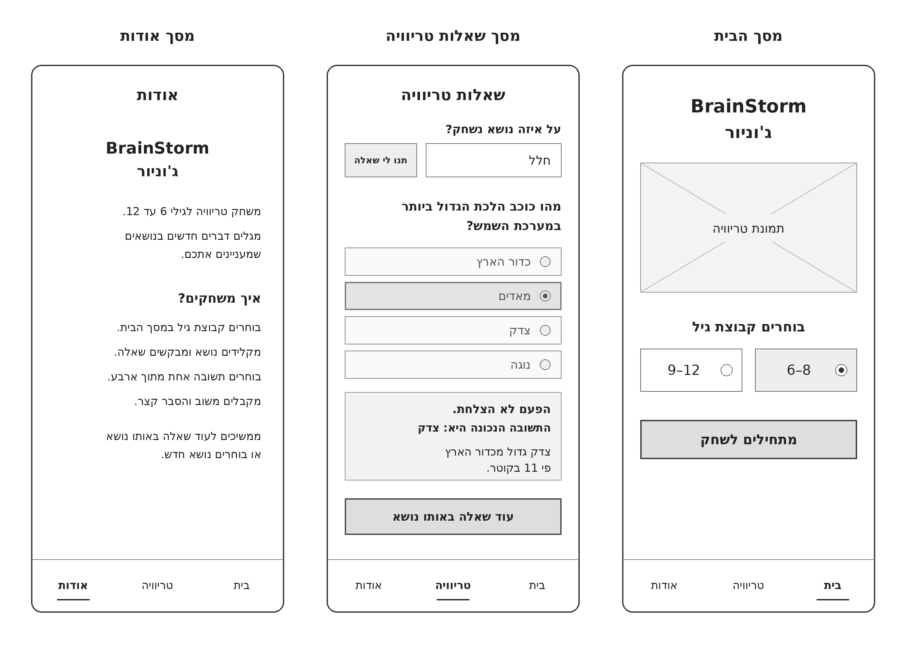
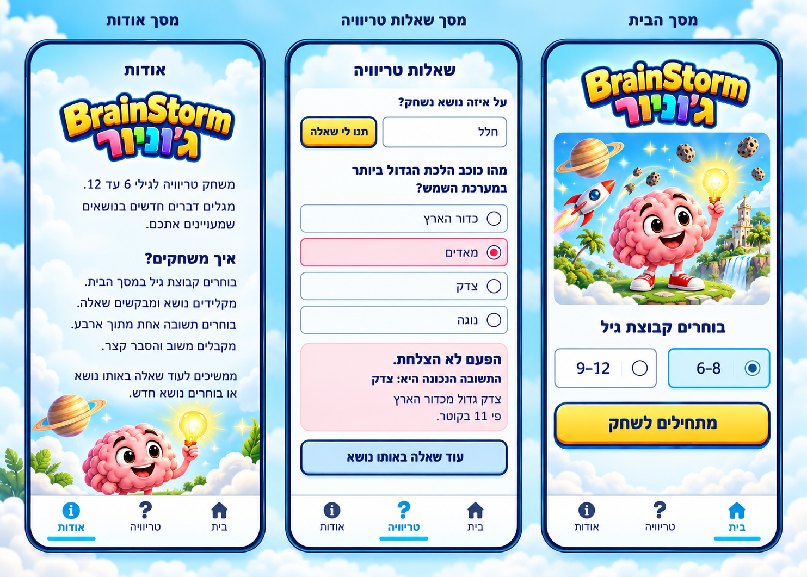
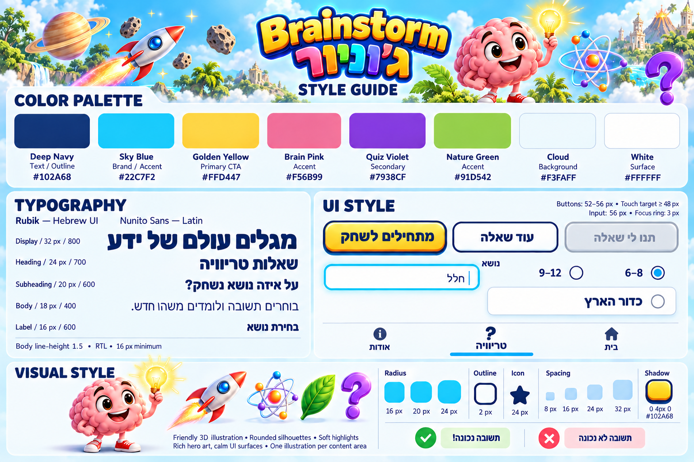

# DESIGN — BrainStorm ג'וניור

מסמך עיצוב ל־MVP, המבוסס על ה־PRD ועל תמונות ה־Wireframes, ה־Style Guide וה־Mockups שנוצרו עבור המוצר.

ה־PRD קובע את ההתנהגות; ה־Wireframes קובעים את המבנה והתוכן; ה־Style Guide קובע את ערכי העיצוב; ה־Mockups מדגימים את המראה הסופי. התוכן בדוגמאות הטריוויה מייצג שאלה אחת ואינו תוכן קבוע לכל משחק.

שלוש התמונות שלהלן נדרשות באותה תיקייה של מסמך זה, בשמות המצוינים בנתיבים היחסיים.

## 1. Screens — מסכי האפליקציה

המוצר כולל שלושה מסכים: מסך הבית, מסך שאלות טריוויה ומסך אודות. בלוחות הם מסודרים מימין לשמאל: בית, טריוויה, אודות. כותרות שמות המסכים שמעל המסגרות הן תוויות של לוח העיצוב ואינן כותרות נוספות בתוך האפליקציה.

### מבנה המסכים — Wireframes

### המראה הסופי — Mockups

### 1.1 מסך הבית

**מטרת המסך:** כניסה למשחק ובחירת קבוצת הגיל.

**מבנה ותוכן, מלמעלה למטה:**

- לוגו ממורכז: BrainStorm ומיד מתחתיו „ג'וניור”. ב־Mockup הוא מופיע באותיות עבות בעלות נפח, קו מתאר כחול כהה וצבעוניות צהובה ורב־גונית.
- תמונת Hero מלבנית עם פינות מעוגלות, ברוחב אזור התוכן. האיור מציג מוח ורוד חייכני עם נורה, לצד אלמנטים של חלל, מדע וטבע. הוא מחליף את מציין המקום „תמונת טריוויה” שב־Wireframe; אין להציג את מציין המקום בממשק המעוצב.
- הכותרת „בוחרים קבוצת גיל”, ממורכזת.
- שתי אפשרויות בחירה בשורה: 6–8 מימין ו־9–12 משמאל. בכל אפשרות Radio מימין לתווית. בדוגמה 6–8 נבחרה, עם רקע תכלת בהיר, מסגרת Cyan וסימון Radio מלא; האפשרות השנייה לבנה עם מסגרת עדינה.
- כפתור Primary רחב „מתחילים לשחק”, בצהוב עם טקסט וקו מתאר כחולים כהים וצל תחתון.
- אזור מרווח לפני הניווט התחתון. „בית” הוא הפריט הפעיל.

**מסכים נמוכים:** בטלפון נמוך (גובה מסך עד כ־740 px, למשל iPhone SE) הלוגו והתמונה הראשית מוצגים מעט קטנים יותר — הלוגו ברוחב עד 240 px והתמונה בגובה עד 200 px, חתוכה לרוחב בלי עיוות — כך שבחירת הגיל והכפתור „מתחילים לשחק” נראים מעל הניווט התחתון בלי גלילה. במסכים גבוהים יותר המראה אינו משתנה.

**פעולות וניווט:** בחירת קבוצת גיל ולחיצה על „מתחילים לשחק” מובילות לטריוויה. הניווט התחתון מאפשר גישה למסכים האחרים בהתאם להתנהגות שהוגדרה ב־PRD.

### 1.2 מסך שאלות טריוויה

**מטרת המסך:** בחירת נושא, מענה לשאלה וקריאת המשוב וההסבר.

**מבנה ותוכן, מלמעלה למטה:**

- כותרת ממורכזת „שאלות טריוויה”. התוכן שמתחתיה מונח על משטח בהיר ושקט כדי לשמור על קריאות.
- תווית מיושרת לימין „על איזה נושא נשחק?”. מתחתיה שדה הנושא מימין והכפתור „תנו לי שאלה” משמאל. בדוגמה ערך השדה הוא „חלל”; הכפתור צהוב ומעוגל.
- טקסט השאלה מודגש ומיושר לימין. בדוגמה: „מהו כוכב הלכת הגדול ביותר במערכת השמש?”, בשתי שורות.
- ארבע אפשרויות תשובה בטור, בכרטיסים מעוגלים ברוחב אחיד. סדר הדוגמה: „כדור הארץ”, „מאדים”, „צדק”, „נוגה”. בכל כרטיס הטקסט וה־Radio ממוקמים בצד ימין.
- ה־Wireframe וה־Mockup מציגים מצב לאחר תשובה שגויה: „מאדים” מסומנת. ב־Mockup הכרטיס הנבחר בעל רקע ורוד בהיר, מסגרת ורודה ו־Radio מלא; יתר הכרטיסים בהירים עם מסגרת דקה.
- מתחת לאפשרויות מופיע כרטיס משוב ורוד בהיר. ההודעה והתשובה הנכונה מודגשות; ההסבר מתחתיהן במשקל רגיל:
  - „הפעם לא הצלחת.”
  - „התשובה הנכונה היא: צדק”
  - „צדק גדול מכדור הארץ פי 11 בקוטר.”
- כפתור רחב „עוד שאלה באותו נושא”, בתכלת בהיר עם מסגרת כחולה כהה וצל תחתון, כפי שמופיע ב־Mockup.
- ניווט תחתון, שבו „טריוויה” פעיל.

**פעולות וניווט:** הזנת נושא ובקשת שאלה; בחירת תשובה לפני נעילתה; לאחר המשוב — בקשת שאלה נוספת או שינוי הנושא דרך השדה הקיים. מעבר לבית או לאודות דרך הניווט התחתון. אין כפתור אישור תשובה נפרד.

**גלילה אוטומטית למשוב:** לאחר בחירת תשובה, אם כרטיס המשוב או הכפתור „עוד שאלה באותו נושא” אינם נראים במלואם (למשל בטלפון נמוך), המסך נגלל בעדינות עד שהם נראים מעל הניווט התחתון. כשהם כבר נראים — אין גלילה. למשתמשים שביקשו להפחית תנועה במכשיר הגלילה מיידית ולא הדרגתית.

מצב המענה שבצילום אינו מסך תוצאה נפרד. מצבי טעינה, הצלחה ושגיאה שהוגדרו ב־PRD משתמשים באותו מסך וברכיביו; אין להסיק מהם מסכים נוספים. הנוסחים וההתנהגות שלהם נקבעים ב־PRD, ולא לפי התשובה השגויה שבדוגמה.

### 1.3 מסך אודות

**מטרת המסך:** הצגת הסבר קצר על המשחק ואופן השימוש בו.

**מבנה ותוכן, מלמעלה למטה:**

- הכותרת „אודות”, ממורכזת.
- לוגו BrainStorm ג'וניור ממורכז מתחת לכותרת.
- פסקת פתיחה מיושרת לימין: „משחק טריוויה לגילי 6 עד 12. מגלים דברים חדשים בנושאים שמעניינים אתכם.”
- כותרת משנה מודגשת „איך משחקים?”.
- הוראות קצרות, מיושרות לימין ומופרדות במרווחים: „בוחרים קבוצת גיל במסך הבית.”; „מקלידים נושא ומבקשים שאלה.”; „בוחרים תשובה אחת מתוך ארבע.”; „מקבלים משוב והסבר קצר.”; „ממשיכים לעוד שאלה באותו נושא או בוחרים נושא חדש.”
- ב־Mockup מופיע איור דקורטיבי בתחתית התוכן: המוח עם הנורה, כוכב לכת וצמחייה. האיור אינו לחיץ ואינו מחליף את הטקסט.
- ניווט תחתון, שבו „אודות” פעיל.

**פעולות וניווט:** קריאת ההסבר ומעבר לבית או לטריוויה באמצעות הניווט הקבוע. אין טופס או פעולה מרכזית נוספת במסך.

### 1.4 מבנה הניווט הכללי

בכל המסכים מופיע אותו Bottom Navigation, עם שלושה פריטים בלבד. הסדר מימין לשמאל: „בית”, „טריוויה”, „אודות”. מעל כל תווית אייקון: בית, סימן שאלה וסמל מידע, בהתאמה. הפריט הפעיל מודגש ב־Cyan באמצעות האייקון, הטקסט וקו תחתון; יתר הפריטים בכחול כהה.

בחירת קבוצת הגיל מתבצעת בבית לפני תחילת המשחק. מעבר בין המסכים אינו דורש מסך ביניים. אזור הניווט נפרד מהתוכן בקו עדין ונשאר בתחתית ה־Viewport בלי להסתיר רכיבים.

## 2. Style Guide — השפה העיצובית

### 2.1 Color Palette

| Token | HEX | שימוש |
| --- | --- | --- |
| Deep Navy | `#102A68` | טקסט מרכזי, כותרות, קווי מתאר, אייקונים וצל כפתורים. |
| Sky Blue | `#22C7F2` | הדגשות מותג, Focus, פריט ניווט פעיל ובחירת קבוצת גיל. |
| Golden Yellow | `#FFD447` | כפתור Primary והדגשות בלוגו ובאיורים. |
| Brain Pink | `#F56B99` | צבע משני באיור ובשפה המשחקית. ב־Mockup גוונים ורודים משמשים גם לסימון הטעות. |
| Quiz Violet | `#7938CF` | צבע Secondary והדגשות באיורים ובסימני השאלה. |
| Nature Green | `#91D542` | הדגשות טבע ופרטים באיור. |
| Cloud | `#F3FAFF` | רקע בסיס בהיר. |
| White | `#FFFFFF` | משטחי תוכן, שדות וכרטיסים. |

טקסט הממשק המרכזי כחול כהה על רקעים בהירים; אין להעתיק את הצבעוניות העשירה של הלוגו לטקסטים ארוכים. ב־Style Guide מופיעים גם משובי הצלחה בירוק וטעות בוורוד/אדום, עם סמל וטקסט. גוני הרקע הבהירים וגוון האדום המדויק אינם מוגדרים שם ב־HEX; אין להתייחס אליהם כאל Tokens מדויקים נוספים. בהיעדר ערך מוגדר יש להתאים חזותית לדוגמת הרכיב, בלי להציג ערך משוער כנתון מקור.

### 2.2 Typography

משפחות הגופנים שנקבעו ב־Style Guide: **Rubik** עבור Hebrew UI ו־**Nunito Sans** עבור טקסט Latin. הלוגו הוא אלמנט גרפי בעל אותיות מעוצבות ונפח; הוא אינו דוגמה לטקסט גוף או תחליף לגופן הממשק.

| תפקיד | גודל מומלץ | Font weight | דוגמה / שימוש |
| --- | --- | --- | --- |
| Display | 32 px | 800 | כותרת בולטת, לפי הצורך במבנה הקיים. |
| Heading | 24 px | 700 | „שאלות טריוויה”, „אודות”. |
| Subheading | 20 px | 600 | „על איזה נושא נשחק?”, „איך משחקים?”. |
| Body | 18 px | 400 | הסברים והוראות. |
| Label | 16 px | 600 | תוויות קצרות ורכיבי ממשק. |

ה־Style Guide מגדיר Body line-height של 1.5 וגודל טקסט מזערי של 16 px. היררכיית הטקסט נשמרת באמצעות גודל ומשקל, ולא באמצעות הוספת מסגרות או צבעים לכל שורה. חלוקת שורות מסתגלת לרוחב המכשיר; אין לקבע שבירת שורה באופן שיחתוך תוכן.

### 2.3 UI Style

| רכיב | מימוש חזותי |
| --- | --- |
| Primary Button | רקע צהוב, טקסט Navy מודגש, פינות מעוגלות, מסגרת Navy וצל תחתון קצר. דוגמה: „מתחילים לשחק”. |
| Secondary Button | ב־Style Guide רקע לבן עם מסגרת Navy; ב־Mockup כפתור ההמשך משתמש במשטח תכלת בהיר, עם אותה מסגרת וצל. עבור „עוד שאלה באותו נושא” המראה הסופי הוא זה שב־Mockup. |
| Disabled Button | משטח אפור בהיר, טקסט ומסגרת אפורים, ללא הדגשה צבעונית פעילה. |
| Text Input | משטח לבן, פינות מעוגלות, קו מתאר עדין, ערך מיושר לימין ותווית חיצונית מעליו. Focus ring ב־Cyan. |
| Age Radio | שתי יחידות בחירה בעלות פינות מעוגלות; Radio מימין למספר. האפשרות הנבחרת מקבלת מסגרת Cyan ומשטח תכלת בהיר. |
| Answer Card | משטח בהיר, מסגרת עדינה ופינות מעוגלות; Radio וטקסט מימין. במצב הטעות המוצג, הכרטיס הנבחר ורוד עם סימון מלא. |
| Feedback Card | רקע ורוד בהיר במצב הטעות; הודעה ותשובה נכונה מודגשות, והסבר במשקל רגיל. צבע אינו האמצעי היחיד להעברת המשוב. |
| Bottom Navigation | משטח בהיר, קו הפרדה עליון, אייקון מעל תווית, שלושה פריטים בריווח שווה. מצב פעיל ב־Cyan ובקו תחתון. |

גובה כפתורים לפי ה־Style Guide: 52–56 px; Touch target של לפחות 48 px. גובה שדה קלט: 56 px; עובי Focus ring: 3 px. אלה מידות רכיבים מומלצות בממשק, ולא מידות שיש למדוד מתוך קובץ ה־PNG המוקטן או המוגדל.

### 2.4 Visual Style ו־Layout

**אופי חזותי:** עולם גילוי משחקי וצבעוני, עם איורי 3D ידידותיים, צורות עגלגלות והברקות רכות. המוח הוורוד עם הנורה הוא הדמות הבולטת; חלל, טבע ומדע מספקים את המוטיבים הנלווים. המראה עשיר באזורי האיור ושקט יותר באזורי קריאה ופעולה.

**רקע ומשטחים:** ב־Mockups נראים שמיים ותכלת עם עננים, לצד משטחי תוכן לבנים ובהירים. במסך הטריוויה משטח התוכן מפחית עומס מאחורי השאלה, האפשרויות והמשוב. איורים אינם חופפים לטקסט או לכפתורים.

**צורות ומידות:** ה־Style Guide מגדיר Radius של 16, 20 ו־24 px, קו מתאר עיקרי בעובי 2 px ואייקונים בגודל 24 px. אין במקורות מיפוי מספרי מחייב של כל Radius לכל רכיב; יש לשמור על הצורה המעוגלת והעקביות הנראות ב־Mockups.

**צללים:** Token הצל המפורש הוא `0 4px 0 #102A68`: צל תחתון קצר ללא Blur, בעיקר לרכיבי פעולה. ההברקות באיורים ובלוגו הן חלק מהנכס הגרפי, ולא אפקט שיש להוסיף לכל משטח בממשק.

**Spacing:** סולם המרווחים המוגדר הוא 8, 16, 24 ו־32 px. יש לשמור על שוליים צדדיים עקביים, רווחים שווים בין תשובות והפרדה ניכרת בין קבוצות תוכן. במקורות לא ניתנו ערכים מדויקים לכל רווח; הסולם והיחסים החזותיים הם הבסיס, ולא מדידות משוערות מהתמונה.

**פריסה:** Mobile-first, עם עמודת תוכן אחת. החריגים המופיעים במקורות הם שורת הנושא והכפתור ושורת שתי קבוצות הגיל. הכפתורים המרכזיים וכרטיסי התשובה נפרסים לרוחב אזור התוכן. בהצגת טקסט ארוך או במכשיר נמוך יותר התוכן יכול להיגלל מעל אזור הניווט; אין להקטין את הטקסט כדי לשחזר צילום סטטי.

מסגרות ה־Smartphone מסביב למסכים בלוחות הן אמצעי הצגה של ה־Mockups ואינן רכיב שיש לצייר בתוך האתר. גם הרקע שמחוץ למסגרות אינו אזור תוכן באפליקציה.

### 2.5 שפה וכיווניות

- שפת הממשק עברית, עם RTL ברמת המסך.
- טקסטי נושא, שאלה, תשובות, הוראות ומשוב מיושרים לימין. כותרות עליונות, לוגו וטקסטי כפתורים ממורכזים כפי שמופיע במקורות.
- BrainStorm מוצג ב־LTR, בלי להפוך את סדר האותיות; „ג'וניור” מופיע מתחתיו בלוגו.
- טווחי הגיל 6–8 ו־9–12 מוצגים ב־LTR בתוך הרכיב העברי. ה־Radio נשאר מימין לתווית, וסדר האפשרויות נשמר מימין לשמאל.
- סדר הניווט נשאר „בית”, „טריוויה”, „אודות” מימין לשמאל, ללא היפוך הסמלים עצמם.

המסמך מתאר את שלושת המסכים והרכיבים שכבר הוגדרו בלבד. ערכים מספריים נלקחו מה־Style Guide; פרטים שאינם מוגדרים בו במדויק מתוארים לפי הופעתם ב־Mockups, ללא המצאת Design Tokens נוספים.
